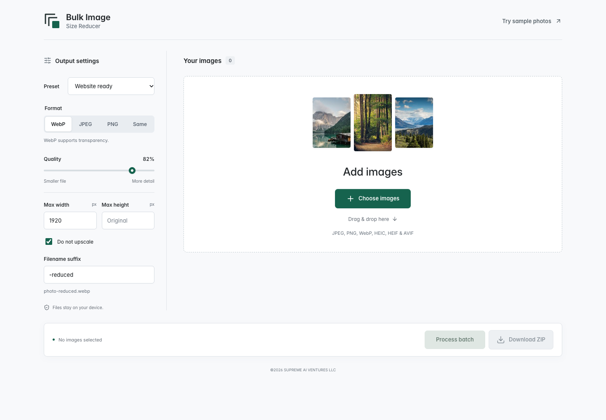
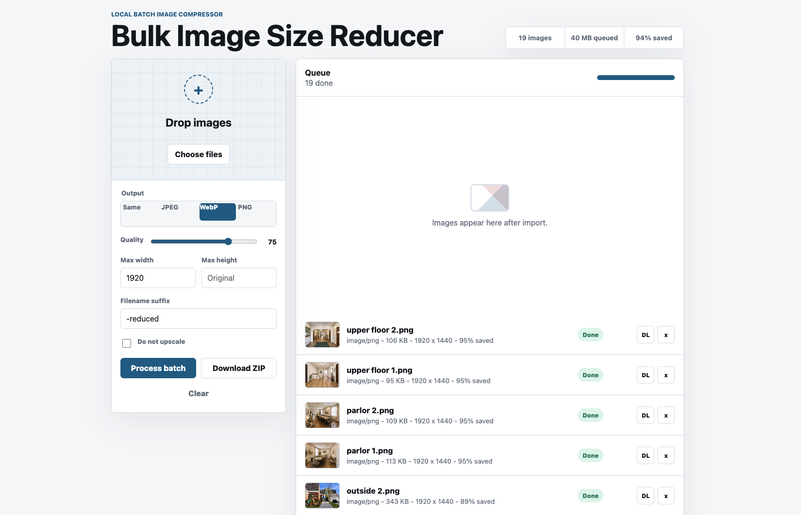
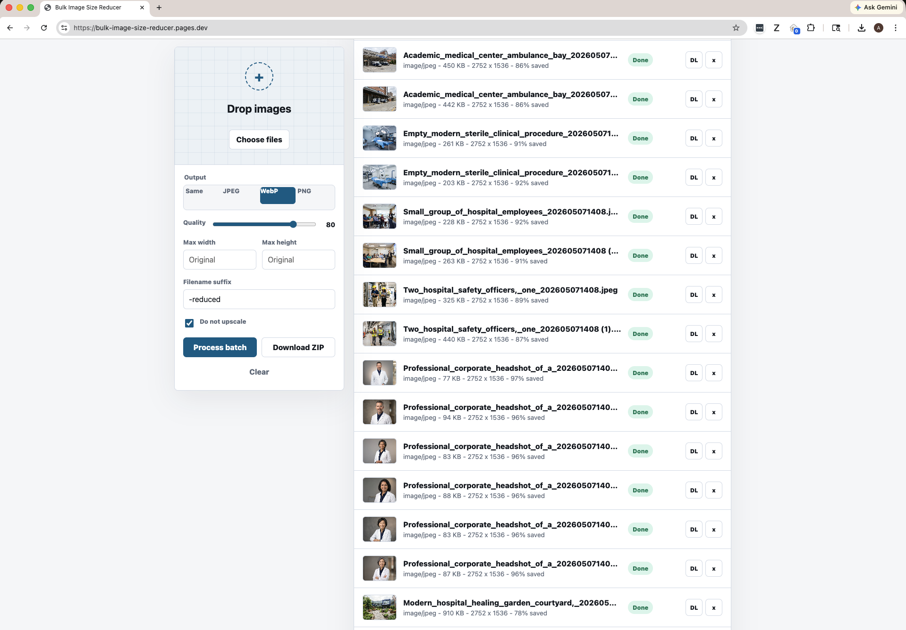
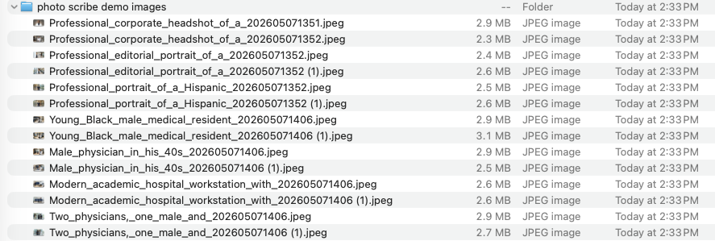
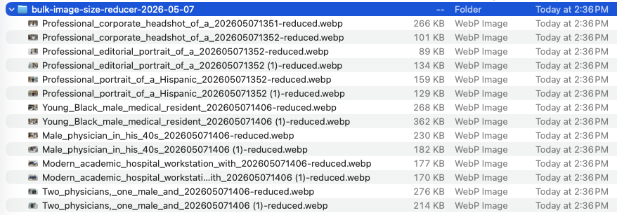

# Bulk Image Size Reducer

A fast, browser-based batch image compressor for people who want the practical parts of Squoosh without feeding files through one at a time.

Select or drop multiple images, choose an output format, tune quality and max dimensions, then download individual results or a single ZIP.

Live app: [bulk-image-size-reducer.pages.dev](https://bulk-image-size-reducer.pages.dev)



## About

Bulk Image Size Reducer is a static web app for reducing many images locally in the browser. It is built for practical batch cleanup: import JPEG, PNG, WebP, AVIF, HEIC, and HEIF files; convert to WebP, JPEG, PNG, or the source format when browser-supported; cap dimensions without upscaling; compare per-file savings; and export a completed batch as a ZIP.

The project has no application backend and no upload pipeline. Image decode, resize, encode, preview, download, and ZIP generation all run client-side with browser APIs, which keeps the tool easy to host and keeps selected files on the user's device.

## Tech Stack

- HTML
- CSS
- JavaScript
- Self-hosted Inter variable typeface and SVG icons
- Browser File APIs
- Canvas API
- Blob and Object URL APIs
- Vendored `heic2any` HEIC/HEIF browser conversion
- Client-side ZIP generation
- Node.js static development server

## Engineering Highlights

- Runs fully client-side with no image uploads or backend processing.
- Handles batch queue state, previews, resizing, encoding, and ZIP export in vanilla JavaScript.
- Uses browser-native APIs for the main resize, encode, download, and ZIP pipeline.
- Converts HEIC and HEIF inputs in-browser before sending them through the same canvas export flow.
- Detects WebP export support and offers working JPEG/PNG alternatives when unavailable.
- Supports batch cancellation, per-file recovery, original/result comparisons, and collision-safe ZIP filenames.
- Tests real image exports, HEIC conversion, ZIP integrity, accessibility, and 100-image batches in Chrome and WebKit.
- Includes ADRs and a C4-style architecture diagram for the main implementation decisions.

## Batch Results Example



## Real Workflow Example

This tool is useful when a site needs many images prepared for the web, not just one polished image. In this example, a folder of high-resolution JPEGs was processed as a batch and exported as WebP files with consistent settings.



Before compression, the source JPEGs were multi-megabyte files:



After batch export, the WebP versions are much smaller and ready for website use:



For image-heavy sites, this turns optimizing large batches, potentially hundreds of assets depending on browser memory, from a tedious one-at-a-time workflow into a repeatable batch process. Smaller image assets can help pages load faster and support better technical SEO by reducing unnecessary transfer size.

## What It Does

- Accepts many images at once with drag-and-drop or file picker upload.
- Imports JPEG, PNG, WebP, AVIF, HEIC, and HEIF images.
- Exports to WebP, JPEG, PNG, or the original supported format.
- Compresses with a quality slider for JPEG and WebP.
- Resizes by max width and/or max height while preserving aspect ratio.
- Avoids accidental upscaling with the no-upscale option.
- Shows per-image status, dimensions, output size, and percent saved.
- Downloads single processed images or the whole batch as a ZIP.
- Offers Website ready, Smallest files, and Keep more detail presets, plus custom settings.
- Compares originals and results at fit-to-window or full pixel size.
- Stops a batch after the current image without losing completed results.
- Keeps output settings on the left on desktop and fully exposed on mobile.

The default Website ready preset uses WebP at 82% quality and a 1920 px maximum width. Browsers without WebP canvas export start with JPEG at 60%; encoder quality values are not equivalent across formats or browsers. PNG preserves transparency without a lossy quality setting. Choose PNG instead of JPEG when transparent backgrounds matter.

## Why This Exists

Squoosh is excellent for carefully tuning one image, but its public app is not built for quick bulk work. This tool is meant for the everyday batch case: resize and reduce a set of website images with consistent settings, then move on. It avoids launching Adobe Lightroom or a heavier desktop editing workflow just to prepare web images for faster-loading pages.

## Architecture

- [Architecture overview and C4 diagram](docs/architecture.md)
- [Architecture decision records](docs/adrs/README.md)

## Run in Development

No install step is required beyond Node.js.

```sh
npm start
```

Then open:

```text
http://127.0.0.1:4173
```

The included server only serves the static files in this folder.

## Verification

Install development-only test dependencies and the WebKit test browser. Chrome must also be installed:

```sh
npm ci
npx playwright install webkit
npm run check
npm test
git diff --check
```

Tests cover the browser workflow and real file downloads, not a native app wrapper. See the [product-quality audit](docs/product-quality.md) for evidence and remaining device-release checks.

## Deploy

The app is static, so it can be hosted on Cloudflare Pages, GitHub Pages, Netlify, Vercel, or any plain static host. Build an allowlisted release directory so development packages, tests and repository files are not published. For Cloudflare Pages:

```sh
npm run build
npx wrangler pages deploy dist --project-name bulk-image-size-reducer
```

## Cost Model

The app does not run image processing in the cloud. Each visitor's browser decodes, resizes, compresses, previews, zips, and downloads their selected files on that visitor's device.

That means heavy processing usage does not create per-image server CPU, worker, queue, storage, or upload costs for this project. The costs that can scale are ordinary static-site hosting costs: requests and bandwidth for serving HTML, stylesheets, JavaScript, fonts, icons, sample photos and the on-demand HEIC/HEIF converter. Hosting providers may also enforce plan limits, bandwidth policies, or abuse protections, so production operators should check the current limits for their chosen static host.

The cost model would change if the project later added uploads, server-side compression, stored image history, accounts, analytics, APIs, queues, or object storage.

## Privacy

Image processing happens in your browser. Files are decoded, resized, compressed, and zipped client-side; they are not uploaded to an application server by this project.

## Limitations

- Compression uses the browser canvas encoder, so output can differ from Squoosh's full codec stack.
- JPEG, PNG, WebP, AVIF, HEIC and HEIF can be imported when the browser or bundled converter can decode their particular codec variant. GIF and SVG inputs are rejected; folder traversal is not supported.
- HEIC and HEIF first use native decoding where available, then the bundled converter. Same exports HEIC, HEIF and AVIF as WebP, or PNG when WebP export is unavailable. HEIC originals in the comparison view use a reduced preview, clearly labelled in the dialog.
- Animated WebP/AVIF inputs are flattened to the first decoded frame.
- Multi-image HEIC/HEIF files are flattened to the first decoded image.
- Canvas export strips most metadata by default.
- Batches are capped at 500 files and 500 MB of input, with a 50 MB per-file limit and a separate 500 MB output limit. Source images up to 64 megapixels can be reduced; results are capped at 32 megapixels and 8192 px per side. A generated 48-megapixel JPEG is covered by the browser tests. These are guardrails, not a guarantee that a low-memory device can process every batch at the limit. Decoding still consumes memory before dimensions can be checked. Use smaller batches on phones.
- Stop finishes the current image; it cannot interrupt a browser canvas encode already in progress.
- Queue and results live in memory. Download before closing the tab. Compression can produce a larger file; the app reports this rather than claiming savings.

## Project Structure

```text
.
|-- app.js        # Batch processing, canvas export, and ZIP creation
|-- build.mjs     # Copies runtime assets into dist/ for deployment
|-- index.html    # Static app shell
|-- server.mjs    # Tiny static server for development
|-- styles.css    # Responsive interface styling
|-- premium.css   # Typography, branding and approved desktop/mobile layouts
|-- assets/       # Bundled photos, thumbnails, icons, brand mark and fonts
|-- tests/        # Chrome/WebKit workflow and accessibility tests
|-- vendor/       # Vendored browser dependencies
`-- docs/
    |-- architecture.md
    |-- adrs/
    |-- image-sizes-after.png
    |-- image-sizes-before.png
    |-- screenshot.png
    |-- workflow-batch-processing.png
    `-- batch-results.png
```
