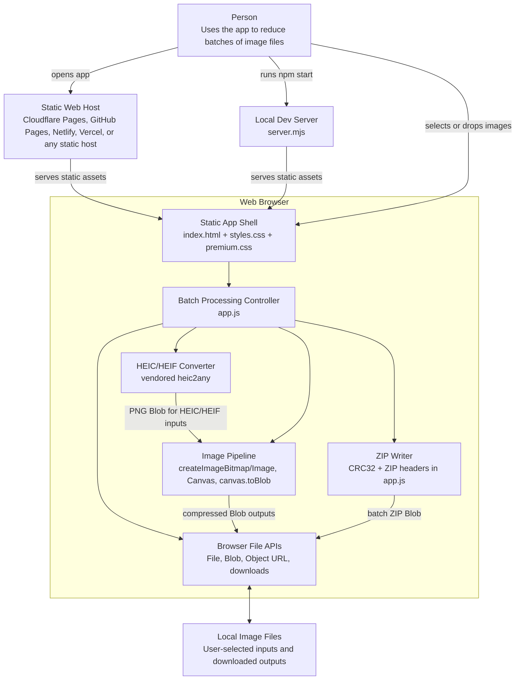

# Architecture

Bulk Image Size Reducer is a static, browser-only image compression app. Its primary architectural constraint is that selected files stay local to the user's device: the app serves HTML, CSS, JavaScript, sample assets and vendored browser dependencies, then all image processing runs in the browser.

## C4 Container Diagram

## Runtime Flow

1. The user opens the static app from a host or the local development server.
2. The browser loads `index.html`, `styles.css`, `premium.css`, `app.js`, the bundled Inter typeface, icons and small sample thumbnails. Full sample photos load only when requested; the HEIC/HEIF converter loads only when native HEIC decoding fails. A small canvas probe detects WebP export capability.
3. The user drops or selects image files. The app validates supported types, empty files, duplicates and batch limits, creates preview object URLs, and tracks queue state in memory.
4. The user chooses output format, quality, max dimensions, suffix, and no-upscale behavior.
5. `app.js` processes files sequentially with `createImageBitmap`, falling back to an `Image` element when needed. HEIC/HEIF inputs unsupported by the browser are converted to PNG by `heic2any`. The converter worker is terminated after each file to release its buffers. Import, settings and removal actions are locked during processing; stopping preserves completed results and leaves the remaining files queued.
6. The app draws each image to a canvas at the target dimensions and exports a Blob with `canvas.toBlob`.
7. The user inspects original/result previews, then downloads individual files or an in-memory ZIP with unique, sanitized filenames. Changing export settings invalidates previous outputs. Failed files can be retried without recompressing successful ones; failed ZIP creation preserves the individual results.

## Deployment Shape

The production app is a static site. The local server exists only for development convenience and serves files from the project root with `no-store` caching. No production API, database, object storage bucket, worker queue, or server-side image processor is required.

`npm run build` copies only the app shell, styles, script, assets and vendored converter into `dist/`. Deploy that directory rather than the repository root; test fixtures and development packages are not production assets.

## Cost Model

The architecture separates app delivery from image processing:

- The static host serves the app shell and browser assets.
- The user's browser performs image decode, resize, compression, ZIP generation, and download creation.
- User-selected source images and generated outputs are not uploaded by this project.

As a result, processing more images does not add cloud processing jobs or application server compute. Usage can still increase static hosting traffic because each visitor downloads the app assets, including the vendored HEIC/HEIF converter. Hosting providers may charge, throttle, or apply limits based on their current static-site plans, request volume, bandwidth, or abuse policies.

Adding server-side uploads, remote processing, persistent storage, background queues, user accounts, or analytics would create a different cost profile and should be reviewed as a separate architecture decision.

## Key Constraints

- Processing large batches depends on browser memory and canvas limits. Guardrails: 500 files, 50 MB per input, 500 MB total inputs and 500 MB total outputs; 64 megapixels per source, 32 megapixels per result and 8192 px per output side. Source dimensions are checked after decoding, and ZIP creation temporarily adds memory use. These limits do not reserve memory or guarantee success on every device.
- Browser encoders decide final compression behavior, so output can vary across browsers.
- HEIC/HEIF support depends on the vendored browser converter and adds extra client-side memory pressure during conversion.
- Canvas export strips most metadata by default.
- Animated and multi-image inputs are flattened to the first decoded frame/image.
- GIF and SVG are not accepted. No folder recursion, persistent queue or cloud fallback is implemented.
- Cancellation takes effect between images, not inside native decoding/encoding. Load and fallback decode operations have timeouts, but native canvas processing still depends on browser responsiveness.
